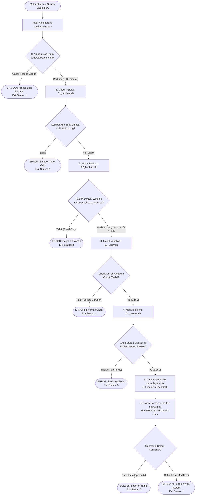
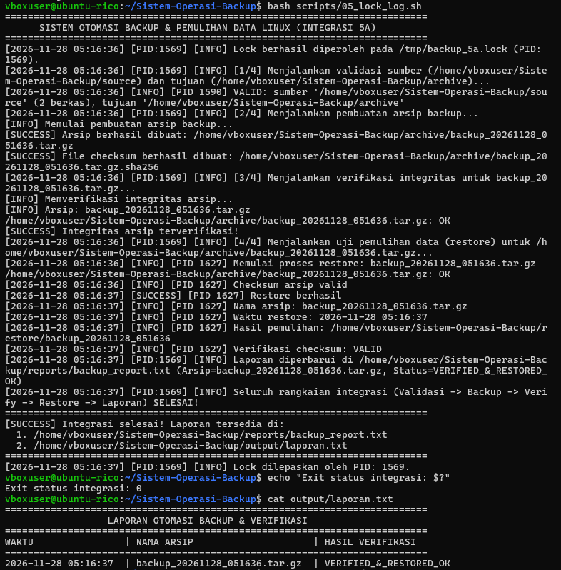
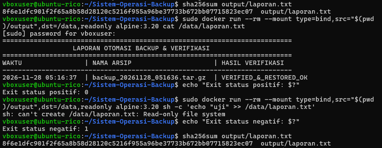
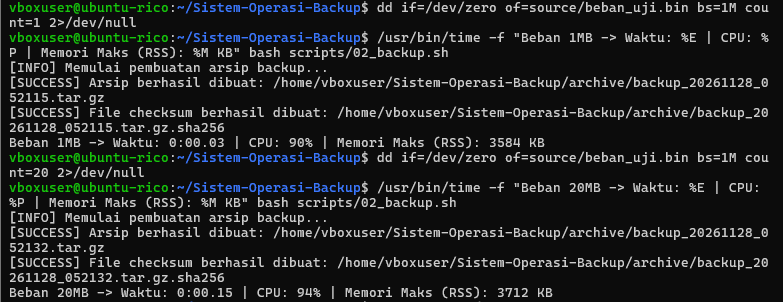
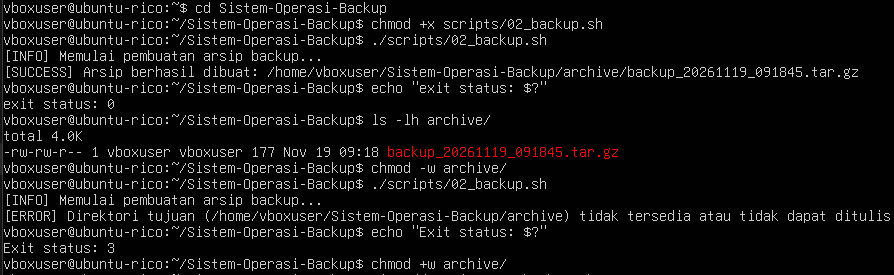

# 🛡️ Sistem Otomasi Backup dan Pemulihan Data Linux (Pilihan 5A)


-2496ED?style=for-the-badge&logo=docker&logoColor=white)


> **Proyek Akhir Mata Kuliah Sistem Operasi & Praktikum Sistem Operasi**  
> **Program Studi S1 Sistem Informasi, Fakultas Ilmu Komputer, UPN Veteran Jakarta**  
> **Kelas / Kelompok:** PBI — Kelompok 3

---

## 📌 1. Deskripsi Proyek
Proyek ini mengembangkan solusi administrasi Linux terotomasi berbasis *shell script* (`bash`) untuk menangani pencadangan (*backup*) dan pemulihan (*restore*) dokumen unit kerja secara aman dan terverifikasi. Sistem ini mengimplementasikan lima pilar utama konsep Sistem Operasi:
1. **Validasi Sistem Berkas:** Pemeriksaan keberadaan *inode* direktori sumber, hak akses baca (`-r`), dan keterisian berkas sebelum proses pencadangan dimulai.
2. **Operasi I/O & Pengarsipan Beridentitas Waktu:** Kompresi direktori sumber menjadi arsip `.tar.gz` ber-timestamp disertai pencetakan otomatis berkas *checksum* `.sha256`.
3. **Verifikasi Integritas Kriptografis:** Pemeriksaan keutuhan blok data arsip menggunakan `sha256sum` untuk mendeteksi korupsi data atau modifikasi tidak sah.
4. **Pemulihan Data Terisolasi (*Restore*):** Validasi pra-ekstraksi dan pemulihan berkas ke direktori uji `restore/` dengan proteksi terhadap arsip rusak.
5. **Sinkronisasi Proses (`flock`), Logging, & Isolasi Docker:** Pencegahan eksekusi proses ganda menggunakan *advisory file locking* kernel, pencatatan laporan ke `output/laporan.txt`, serta pembacaan laporan melalui container Docker dengan *bind mount read-only*.

---

## 👥 2. Anggota Kelompok & Matriks Skenario Individu

| No | Nama Mahasiswa | NIM | Modul Tanggung Jawab & Analisis SO | Skenario Positif (+) | Skenario Negatif (-) |
| :-: | :--- | :---: | :--- | :--- | :--- |
| **1** | **Najwa Aulia** | `2510512129` | **Validasi Sumber & Parameter** (`scripts/01_validate.sh`)<br>*Analisis Sistem Berkas* | Direktori sumber valid & berisi berkas diterima (`Exit 0`) | Direktori sumber tidak ditemukan / kosong ditolak (`Exit 2`) |
| **2** | **Rico Sandika Aryaputra** | `2510512053` | **Pembuatan Arsip `.tar.gz` & `.sha256`** (`scripts/02_backup.sh`)<br>*Analisis I/O & Permission* | Arsip `.tar.gz` & `.sha256` terbentuk di `archive/` (`Exit 0`) | Direktori tujuan *read-only* (`chmod -w`) gagal ditulis (`Exit 3`) |
| **3** | **Kenzia Zahwa Eddyputri** | `2510512121` | **Verifikasi Integritas `sha256sum`** (`scripts/03_verify.sh`)<br>*Analisis Integritas Berkas* | Arsip asli lolos verifikasi `sha256sum -c` (`Exit 0`) | Salinan arsip diubah terdeteksi beda *checksum* (`Exit 4`) |
| **4** | **Vrista Darin Nadira** | `2510512119` | **Pemulihan Data / Restore** (`scripts/04_restore.sh`)<br>*Analisis Pemulihan & Storage* | Data pulih ke `restore/` & identik via `diff -qr` (`Exit 0`) | Arsip rusak gagal *checksum* & *restore* dibatalkan (`Exit 5`) |
| **5** | **Bekti Nur Wicaksono** | `2510512043` | **Lock `flock`, Log, & Docker RO** (`scripts/05_lock_log.sh`)<br>*Analisis Critical Section & Proteksi* | Lock berhasil, laporan tercatat, & Docker baca laporan (`Exit 0`) | Eksekusi ganda ditolak (`Exit 1`) & tulis via mount RO ditolak (`Exit 1`) |

---

## 🔄 3. Diagram Alur Arsitektur Sistem



---

## ⚙️ 4. System Requirements (Prasyarat Sistem)

Sebelum menjalankan proyek ini, pastikan lingkungan mesin virtual (*Virtual Machine*) memenuhi spesifikasi dan paket berikut:

### A. Spesifikasi Lingkungan VM
* **Hypervisor:** Oracle VirtualBox / WSL2 Linux Environment
* **Sistem Operasi:** Ubuntu Server 24.04.5.1 LTS (1–2 vCPU, 2 GB RAM) atau Ubuntu Desktop 24.04.5.1 LTS (2 vCPU, 2–4 GB RAM)
* **Penyimpanan:** Minimal 20 GB Virtual Disk dengan sistem berkas Linux `ext4`

### B. Paket & Utilitas yang Dibutuhkan
Seluruh utilitas inti umumnya telah tersedia di Ubuntu, kecuali Docker yang perlu dipasang terlebih dahulu:
* **Utilitas Inti Linux:** `bash`, `tar`, `gzip`, `sha256sum` (*coreutils*), `flock` (*util-linux*), `diff`, `/usr/bin/time`
* **Version Control & Container:** `git`, `docker.io`
* **Container Image:** `alpine:3.20` (Image ringan ~5 MB untuk pembacaan laporan)

**Perintah Instalasi Paket Prasyarat di Ubuntu:**
```bash
sudo apt update
sudo apt install -y git docker.io time
sudo docker pull alpine:3.20
```

---

## 📂 5. Struktur Direktori Repository

```text
Sistem-Operasi-Backup/
├── README.md                         # Dokumentasi utama proyek
├── .gitignore                        # Aturan pengabaian file VM, arsip uji, dan data sementara
├── config/
│   └── paths.env                     # Konfigurasi variabel path direktori dinamis
├── scripts/
│   ├── 01_validate.sh                # Modul 1: Validasi direktori sumber & parameter (Najwa)
│   ├── 02_backup.sh                  # Modul 2: Pembuatan arsip .tar.gz & .sha256 (Rico)
│   ├── 03_verify.sh                  # Modul 3: Verifikasi integritas sha256sum (Kenzia)
│   ├── 04_restore.sh                 # Modul 4: Pemulihan data ke direktori uji (Vrista)
│   ├── 05_lock_log.sh                # Modul 5: Pipeline Integrasi Utama, Lock flock, & Laporan
│   ├── lock_log_report.sh            # Library fungsi lock flock, logging, & generator laporan (Bekti)
│   ├── test_concurrent_lock.sh       # Script otomatis pengujian 2 proses backup bersamaan
│   └── test_docker_ro.sh             # Script otomatis pengujian Docker bind mount read-only
├── output/
│   └── laporan.txt                   # Berkas laporan utama yang dibaca oleh container Docker
├── tests/
│   └── skenario_pengujian.md         # Dokumentasi langkah uji positif, negatif, & beban CPU/memori
├── docs/                             # Dokumentasi laporan teori Sistem Operasi
└── evidence/                         # Screenshot terminal dan file log bukti pengujian
```

---

## 🚀 6. Langkah-Langkah Menjalankan Sistem (Step-by-Step)

### Langkah 1: Clone Repository & Siapkan Direktori Data Dummy
Buka terminal Ubuntu, lalu jalankan perintah berikut:
```bash
git clone https://github.com/Ricoaryap/Sistem-Operasi-Backup.git
cd Sistem-Operasi-Backup

# Berikan izin eksekusi pada seluruh script
chmod +x scripts/*.sh

# Buat direktori operasional dan data awal
mkdir -p source archive restore output logs reports
echo "Data penting operasional unit kerja Kelompok 3" > source/dokumen_utama.txt
echo "Rekapitulasi data praktikum sistem operasi" > source/data_tambahan.txt
```

### Langkah 2: Menjalankan Sistem Secara Terintegrasi Penuh
Untuk menjalankan seluruh alur secara otomatis jalankan satu perintah ini:
```bash
bash scripts/05_lock_log.sh
echo "Exit status integrasi: $?"

# Tampilkan tabel laporan hasil eksekusi
cat output/laporan.txt
```

---

## 🧪 7. Langkah-Langkah Pengujian Skenario Positif (+) & Negatif (-)

### A. Skenario Anggota 1 — Validasi Sumber (`01_validate.sh`)
```bash
# Kondisi Positif (+): Sumber valid & berisi data (Target: Exit 0)
./scripts/01_validate.sh source archive
echo "Exit status: $?"

# Kondisi Negatif (-): Sumber tidak ditemukan (Target: Exit 2)
./scripts/01_validate.sh folder_tidak_ada archive
echo "Exit status: $?"
```

### B. Skenario Anggota 2 — Pembuatan Arsip Backup (`02_backup.sh`)
```bash
# Kondisi Positif (+): Direktori tujuan normal/writable (Target: Exit 0)
./scripts/02_backup.sh
echo "Exit status: $?"
ls -lh archive/

# Kondisi Negatif (-): Direktori tujuan Read-Only (Target: Exit 3)
chmod -w archive/
./scripts/02_backup.sh
echo "Exit status: $?"

# Pemulihan izin direktori tujuan
chmod +w archive/
```

### C. Skenario Anggota 3 — Verifikasi Integritas (`03_verify.sh`)
```bash
# Kondisi Positif (+): Verifikasi arsip asli (Target: Exit 0)
bash scripts/03_verify.sh
echo "Exit status: $?"

# Kondisi Negatif (-): Arsip dimodifikasi 1 baris byte (Target: Exit 4)
ARSIP_ASLI=$(ls -t archive/backup_*.tar.gz | head -n 1)
cp "$ARSIP_ASLI" archive/backup_test.tar.gz
cp "${ARSIP_ASLI}.sha256" archive/backup_test.tar.gz.sha256
sed -i 's|'"$(basename "$ARSIP_ASLI")"'|backup_test.tar.gz|g' archive/backup_test.tar.gz.sha256
echo "Modifikasi tidak sah" >> archive/backup_test.tar.gz

bash scripts/03_verify.sh backup_test.tar.gz
echo "Exit status: $?"
rm -f archive/backup_test.tar.gz*
```

### D. Skenario Anggota 4 — Pemulihan Data / Restore (`04_restore.sh`)
```bash
# Kondisi Positif (+): Restore arsip valid & cek kesamaan isi (Target: Exit 0)
ARSIP_ASLI=$(ls -t archive/backup_*.tar.gz | head -n 1)
./scripts/04_restore.sh "$ARSIP_ASLI"
echo "Exit status: $?"

# Kondisi Negatif (-): Restore arsip rusak/korup (Target: Ditolak dengan Exit 5)
cp "$ARSIP_ASLI" archive/backup_rusak.tar.gz
cp "${ARSIP_ASLI}.sha256" archive/backup_rusak.tar.gz.sha256
echo "korup" >> archive/backup_rusak.tar.gz
./scripts/04_restore.sh archive/backup_rusak.tar.gz
echo "Exit status: $?"
rm -f archive/backup_rusak.tar.gz*
```

### E. Skenario Anggota 5 — Uji Konkurensi Dua Proses Bersamaan (`flock`)
```bash
# Menjalankan 2 proses backup bersamaan (Proses 1 Exit 0, Proses 2 Ditolak Exit 1)
./scripts/test_concurrent_lock.sh
```

---

## 🐳 8. Aktivitas Docker Sederhana (Bind Mount Read-Only)

Layanan utama pencadangan berjalan pada Linux host. Container Docker (`alpine:3.20`) digunakan khusus untuk membaca `output/laporan.txt` dengan mode *bind mount read-only*:

```bash
# 1. Catat checksum laporan di host SEBELUM pengujian Docker
sha256sum output/laporan.txt

# 2. Kondisi Positif (+): Container membaca laporan (Target: Tampil & Exit 0)
sudo docker run --rm \
  --mount type=bind,src="$(pwd)/output",dst=/data,readonly \
  alpine:3.20 cat /data/laporan.txt
echo "Exit status positif: $?"

# 3. Kondisi Negatif (-): Container mencoba menulis ke mount read-only (Target: Ditolak & Exit 1)
sudo docker run --rm \
  --mount type=bind,src="$(pwd)/output",dst=/data,readonly \
  alpine:3.20 sh -c 'echo "uji perubahan" >> /data/laporan.txt'
echo "Exit status negatif: $?"

# 4. Catat checksum laporan di host SESUDAH pengujian (Terbukti TETAP SAMA / IDENTIK)
sha256sum output/laporan.txt
```

---

## 📊 9. Pengujian Beban CPU dan Memori (2 Ukuran Beban Uji Aman)

Untuk mengamati perilaku penggunaan CPU dan memori fisik (*Maximum Resident Set Size / RSS*) pada 2 ukuran beban uji yang aman (1 MB vs 20 MB):

```bash
# Beban Uji 1 (Kecil: 1 MB)
dd if=/dev/zero of=source/beban_uji.bin bs=1M count=1 2>/dev/null
/usr/bin/time -f "Beban 1MB -> Waktu: %E | CPU: %P | Memori Maks (RSS): %M KB" bash scripts/02_backup.sh

# Beban Uji 2 (Sedang: 20 MB)
dd if=/dev/zero of=source/beban_uji.bin bs=1M count=20 2>/dev/null
/usr/bin/time -f "Beban 20MB -> Waktu: %E | CPU: %P | Memori Maks (RSS): %M KB" bash scripts/02_backup.sh

# Bersihkan berkas beban uji
rm -f source/beban_uji.bin
```

---

## 🧹 10. Prosedur Pembersihan dan Pemulihan Kondisi (Recovery)

Apabila selesai melakukan pengujian skenario negatif dan ingin mengembalikan kondisi ruang kerja ke keadaan bersih awal:
```bash
chmod +w archive/ restore/ source/ 2>/dev/null || true
rm -f source/beban_uji.bin archive/backup_test.tar.gz* archive/backup_rusak.tar.gz*
rm -rf restore/* /tmp/backup_5a.lock
echo "Data penting operasional unit kerja Kelompok 3" > source/dokumen_utama.txt
```

---

## 📸 11. Galeri Bukti Eksekusi Terminal (`evidence/`)

Seluruh bukti tangkapan layar dan log pengujian tersimpan di dalam folder [`evidence/`](./evidence/):

### 1. Bukti Integrasi Penuh 5 Modul (`05_lock_log.sh`)


### 2. Bukti Uji Docker Bind Mount Read-Only & Verifikasi Checksum (`alpine:3.20`)


### 3. Bukti Pengamatan Beban Uji CPU & Memori (1 MB vs 20 MB)


### 4. Bukti Pengujian Pembuatan Arsip & Proteksi Read-Only (`02_backup.sh`)

